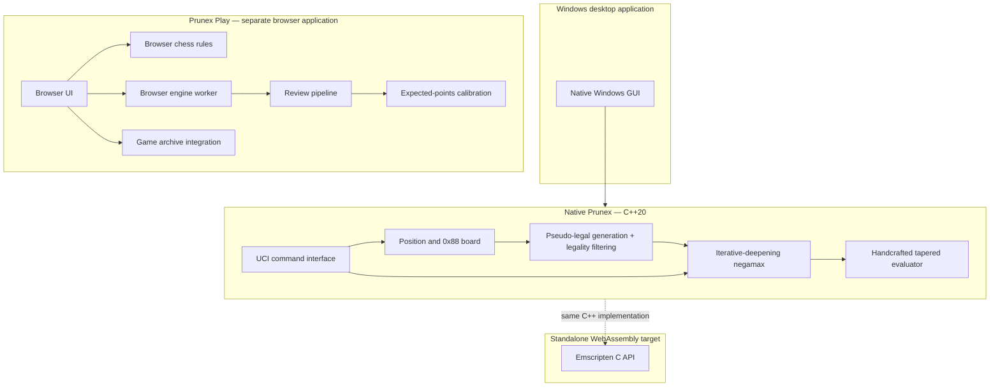
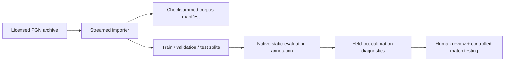

# Prunex architecture

This document describes the current repository architecture. It distinguishes implemented components from future integration work.

## System overview

The standalone WebAssembly build is parity-tested against a native reference, but the current Prunex Play browser worker is not yet connected to that WebAssembly module. Do not represent the native and browser engine paths as one runtime.

## Native engine data flow

1. The UCI interface loads a start position or FEN and applies the supplied move sequence.
2. The position layer stores board state in a 128-slot 0x88 representation.
3. Pseudo-legal moves are generated, then filtered by king-safety checks.
4. Search uses iterative deepening, negamax alpha–beta/PVS, move ordering, a transposition table, aspiration windows, late-move reductions, and quiescence.
5. The static evaluator calculates material and handcrafted positional terms, then blends middlegame and endgame scores by game phase.
6. UCI reports search information and the selected best move.

## Native implementation boundaries

| File | Responsibility |
|---|---|
| `src/main.cpp` | Native engine implementation, UCI loop, CLI diagnostics and benchmark |
| `src/gui.cpp` | Windows desktop window, board rendering and interaction |
| `src/wasm_api.cpp` | C-compatible API exported by the Emscripten build |
| `CMakeLists.txt` | Native, Windows, WebAssembly and CTest build definitions |
| `tests/` | Native regression, UCI, GUI smoke and WASM parity tests |

The Windows desktop currently includes the engine implementation translation unit at build time. The architecture review recommends extracting a reusable engine-core library before increasing the number of native front ends.

## Search and evaluation

The native search stores position keys and bounds in a fixed-size transposition table. Move ordering uses the hash move, promotions, captures, killer moves, and history scores. Late-move reductions are applied to later quiet moves when the node is not in check and the move does not give check. Fail-low and fail-high aspiration windows widen and repeat the root search.

The evaluator is handcrafted and tapered. Its terms include material, piece activity, pawn structure, passed/connected pawns, bishop pair, king shelter, and rook-file activity.

## Browser application boundary

The browser application has separate modules for the engine worker, review metrics, evaluation calibration, game database access, account feedback, and UI presentation. It supplies application-level expected-points interpretation and move grading around its own browser engine integration.

The browser application loads the same C++ engine through its WebAssembly build, keeping the search and evaluation implementation consistent across the native and browser targets.

## Offline data workflow

The offline tooling is independent from both live game storage and engine execution:

Position annotation records the native engine's static score; it does not train or change engine weights. Calibration diagnostics measure score-to-outcome interpretation, not playing strength.

## Validation boundaries

- Native CTest validates tested move-generation, position, search and UCI behaviour.
- GCC/Clang/sanitizer/Windows jobs validate the tested compile/runtime configurations.
- WebAssembly parity checks compare the standalone exported API with native reference results.
- Browser tests validate UI, account, archive, review and application integration.
- None of these alone establishes an independent Elo rating, production disaster recovery, external email delivery, or manual Windows 10/11 visual acceptance.
