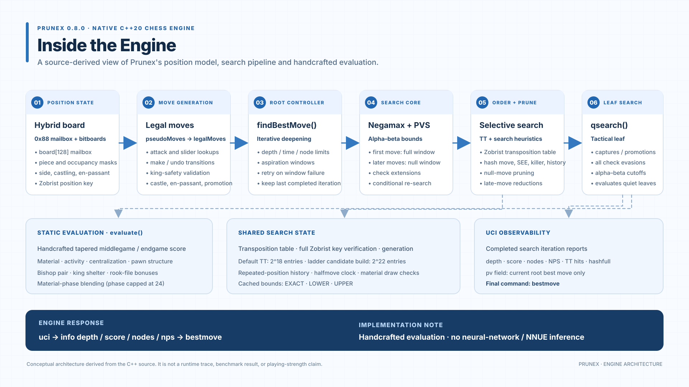

# Prunex native-engine architecture

The graphic is an authored SVG, generated by the standard-library Python script
tools/visualize_engine_architecture.py. It is a source-level explanation of the native
C++20 engine, not an AI-generated image, a runtime trace, or a strength claim.

## Important distinction

The native engine does **not** use a neural network or NNUE inference. Its static evaluator
is handcrafted and tapered between middlegame and endgame. The search uses conventional
game-tree techniques such as iterative deepening, Negamax, alpha-beta pruning, PVS,
transposition-table bounds, move ordering, selective reductions, and quiescence.

## Source map

These references are pinned to the candidate commit used for this diagram:
129829dd95672e83a347563526ae7b28ccf1ea63.

| Diagram component | Implementation |
|---|---|
| 0x88 mailbox and synchronized bitboards | [Position, bitboard rebuild and consistency check — src/main.cpp](https://github.com/Mohamed-Mostafa-AE/Prunex/blob/129829dd95672e83a347563526ae7b28ccf1ea63/src/main.cpp#L31-L110) |
| Sliding attacks and lookup tables | [Attack masks, occupancy subsets and lookup functions](https://github.com/Mohamed-Mostafa-AE/Prunex/blob/129829dd95672e83a347563526ae7b28ccf1ea63/src/main.cpp#L184-L344) |
| Pseudo-legal moves, make/undo and legality filtering | [Move generation and position transitions](https://github.com/Mohamed-Mostafa-AE/Prunex/blob/129829dd95672e83a347563526ae7b28ccf1ea63/src/main.cpp#L345-L618) |
| Zobrist keys and transposition-table entries | [TT entry, configuration, key creation and repetition history](https://github.com/Mohamed-Mostafa-AE/Prunex/blob/129829dd95672e83a347563526ae7b28ccf1ea63/src/main.cpp#L623-L841) |
| Static-exchange evaluation and move ordering | [Capture scoring, SEE, and ordered move list](https://github.com/Mohamed-Mostafa-AE/Prunex/blob/129829dd95672e83a347563526ae7b28ccf1ea63/src/main.cpp#L842-L984) |
| Handcrafted tapered evaluator | [Evaluation maps, material, activity, pawn structure and phase blending](https://github.com/Mohamed-Mostafa-AE/Prunex/blob/129829dd95672e83a347563526ae7b28ccf1ea63/src/main.cpp#L985-L1269) |
| Quiescence search | [Tactical leaf search and check evasions](https://github.com/Mohamed-Mostafa-AE/Prunex/blob/129829dd95672e83a347563526ae7b28ccf1ea63/src/main.cpp#L1270-L1312) |
| Negamax / PVS and pruning | [Recursive search, transposition-table use and selective pruning](https://github.com/Mohamed-Mostafa-AE/Prunex/blob/129829dd95672e83a347563526ae7b28ccf1ea63/src/main.cpp#L1337-L1467) |
| Iterative-deepening root controller | [Time/node limits, aspiration windows, completed iterations and best move](https://github.com/Mohamed-Mostafa-AE/Prunex/blob/129829dd95672e83a347563526ae7b28ccf1ea63/src/main.cpp#L1468-L1535) |
| UCI commands and output | [UCI handshake, options, position/go handling and bestmove](https://github.com/Mohamed-Mostafa-AE/Prunex/blob/129829dd95672e83a347563526ae7b28ccf1ea63/src/main.cpp#L1571-L1748) |
| Configurable native hash-table size | [PRUNEX_TT_BITS CMake setting](https://github.com/Mohamed-Mostafa-AE/Prunex/blob/129829dd95672e83a347563526ae7b28ccf1ea63/CMakeLists.txt#L23-L34) |

## Runtime evidence

The companion workflow builds the exact source commit, runs the native CTest suite, launches
the compiled executable through UCI on two positions, records the emitted depth/score/node/NPS
lines and final bestmove, and records the executable's SHA-256 hash.

After a successful run, the transcript and metadata are stored on the
strength-ladder-progress branch under:

progress/architecture-probes/<source-commit>/run-<workflow-run-id>/

The transcript is generated from the actual executable. It is not hand-authored sample output.

## Reproduce the diagram

From the repository root:

    python3 tools/visualize_engine_architecture.py
    python3 tools/visualize_engine_architecture.py --check

The SVG generation uses only the Python standard library.
