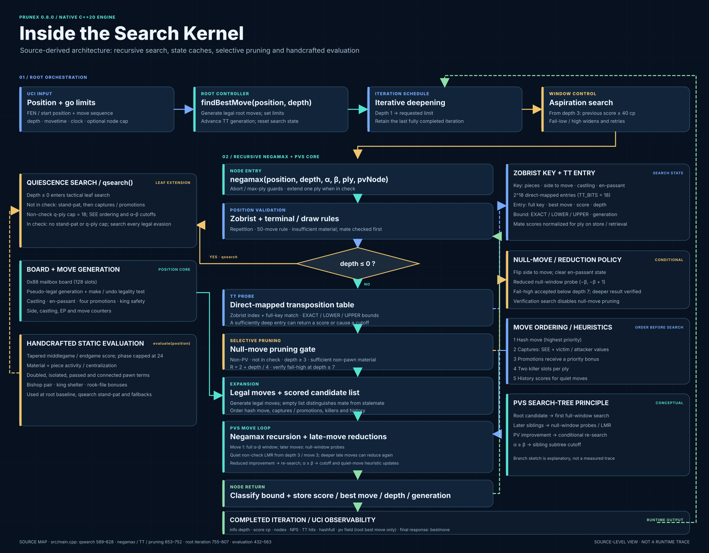

# Prunex 0.8.0 native search kernel

This page describes the **native C++20 engine** in `src/main.cpp`. The diagram uses a layered technical-architecture style, but it is deliberately **not** an NNUE or neural-network diagram: Prunex's current native evaluator is handcrafted, and its search is a recursive alpha–beta/PVS tree.



*Figure: source-level control flow and supporting state. The branching inset is explanatory, not a recorded search trace or fixed tree shape.*

## Search flow

```mermaid
flowchart TD
    A[UCI go / findBestMove] --> B[Generate legal root moves; set limits]
    B --> C[Iterative deepening, depth 1 to limit]
    C --> D[Aspiration window from depth 3: previous score ±40 cp]
    D --> E[negamax(position, depth, alpha, beta, ply, PV)]
    E --> F[Abort / max-ply guards; check extension]
    F --> G[Zobrist key + repetition / 50-move / material draw checks]
    G --> H{depth ≤ 0?}
    H -- Yes --> Q[Quiescence search]
    H -- No --> I[Transposition-table probe]
    I --> J{Usable EXACT / LOWER / UPPER bound?}
    J -- Yes --> R[Return cached score]
    J -- No --> K[Null-move pruning gate]
    K --> L[Generate legal moves]
    L --> M[Order hash move / captures / promotions / killers / history]
    M --> N[PVS recursive move loop]
    N --> O[First move: full window; later moves: null-window]
    O --> P[Late-move reduction; conditional re-search]
    P --> T{alpha ≥ beta?}
    T -- Yes --> U[Cutoff; update killer / history]
    T -- No --> V[Continue remaining moves]
    U --> W[Store TT bound / best move]
    V --> W
    W --> X[Return node score]
    Q --> X
    R --> X
    X --> Y{Aspiration fail-low / fail-high?}
    Y -- Yes --> D
    Y -- No --> Z[Publish completed-iteration UCI info]
    Z --> C
    Z --> AA[Finish with bestmove]
```

## What the implementation actually does

- **Root driver:** `findBestMove` generates legal root moves, configures an optional time/node limit, advances the transposition-table generation, ages history scores, clears killer moves, and iterates from depth 1 to the requested limit. A stopped or aborted iteration does not replace the last fully completed iteration.
- **Aspiration windows:** from depth 3, the initial window is the previous completed score ± 40 centipawns. Fail-low or fail-high doubles the window and retries the same depth.
- **Negamax:** checks cancellation and maximum ply, extends depth by one when the side to move is in check, records Zobrist keys for repetition detection, checks the 50-move and insufficient-material rules, then enters quiescence at depth 0.
- **Transposition table:** a direct-mapped array indexed by the low key bits; entries retain the full key, best move, score, depth, bound (`EXACT`, `LOWER`, or `UPPER`), and generation. Mate scores are normalized for ply on storage and retrieval. The default table has `2^18` entries.
- **Null-move pruning:** gated to suitable non-PV, non-check nodes at depth 3 or greater and below the mate threshold, with sufficient non-pawn material. The null search uses reduction `R = 2 + depth / 4`; cutoffs at depths below 7 are accepted, while deeper cutoffs are verified with null-move disabled.
- **PVS and reductions:** the first move receives a full-window search. Later moves receive a null-window search; quiet late moves may be reduced. A reduced move that improves alpha is re-searched at full child depth, and an in-window PV improvement is then re-searched with the full window.
- **Move ordering:** a matching hash move is first; capture scores include static-exchange evaluation and victim/attacker values; promotions receive a priority bonus; quiet moves can be ordered by killer and history scores. Capture-promotions combine capture and promotion scoring.
- **Quiescence:** when not in check, uses stand-pat evaluation and searches captures/promotions, with a non-check quiescence-ply cap of 18. When in check, it does not use stand-pat or that non-check cap; it searches every legal evasion. It applies alpha–beta cutoffs and terminal mate/stalemate handling.
- **Evaluation:** a handcrafted tapered middlegame/endgame evaluator, blended by material phase (capped at 24). Terms include material, activity/centralization, pawn advancement, doubled/isolated/passed/connected pawns, bishop pair, king shelter, and rook-file bonuses. There is no neural-network or NNUE inference in this native evaluation path.
- **UCI observability:** completed iterations report depth, centipawn score, nodes, NPS, TT hits, hash fullness, and a `pv` field. In the current implementation that field contains the **root best move only**, not a multi-move principal-variation line; the final response emits `bestmove`.

## Generate the diagram

From the repository root:

```bash
python3 tools/visualize_search_kernel.py
```

The script writes `docs/assets/prunex-search-kernel.svg` and uses only Python's standard library. The image is a source-level architecture view, not a runtime trace or strength claim.

## Source of truth

- [Native implementation: `src/main.cpp`](../src/main.cpp)
- [Engine architecture in the README](../README.md#native-engine-architecture)
- [Testing methodology](testing.md)

The architecture is intentionally distinct from the neural-network and NNUE reference diagrams: it shows Prunex's actual recursive search, pruning decisions, caches, board state, and handcrafted evaluation rather than layers of learned weights.
