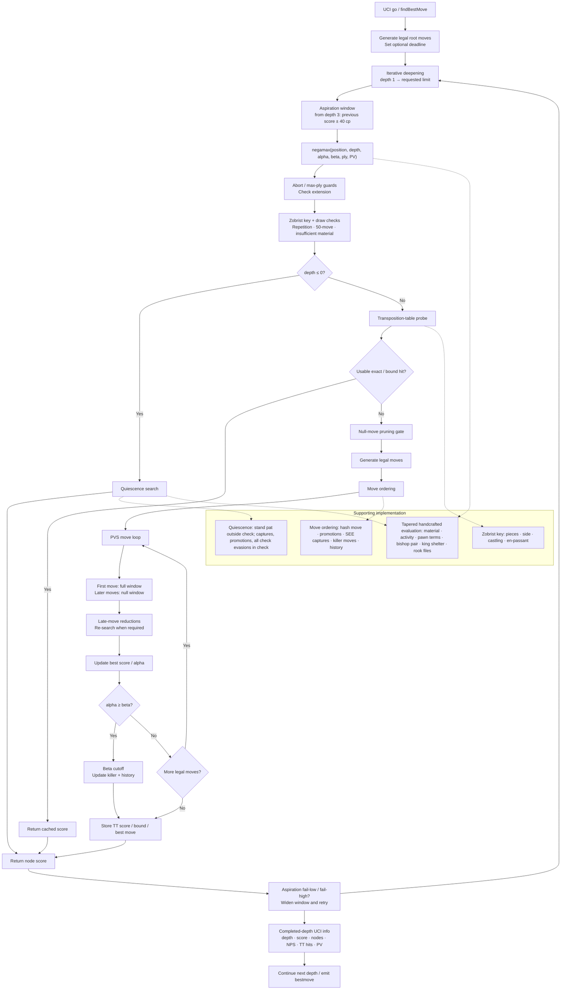

# Prunex 0.8.0 native search kernel

This page describes the **native C++20 engine** in `src/main.cpp`. It is a control-flow map of the implementation, not a neural-network diagram, not a recording of one search, and not a playing-strength claim.

## Search flow



## What the implementation actually does

- **Root search:** `findBestMove` generates legal moves, optionally establishes a time deadline, advances the transposition-table generation, and iterates from depth 1 to the requested limit. Time-limited UCI search is capped at depth 12.
- **Aspiration windows:** from depth 3, the initial window is the previous completed score ± 40 centipawns. Fail-low or fail-high widens the window and retries.
- **Negamax:** checks cancellation and maximum ply, extends the search when in check, records Zobrist keys for repetition handling, checks draw rules, then enters quiescence at depth 0.
- **Transposition table:** entries contain the position key, best move, score, depth, bound type (exact/lower/upper), and generation. Mate scores are normalized for storage and retrieval.
- **Null-move pruning:** gated to suitable non-PV, non-check nodes at depth 3 or greater with sufficient non-pawn material. At depth 7 or greater, a cutoff is verified with a reduced search.
- **PVS and reductions:** the first move gets a full-window search. Later moves get a null-window search; quiet late moves may be reduced, then re-searched if they improve alpha.
- **Move ordering:** hash move, promotions, captures ranked with static-exchange evaluation, killer moves, then history scores.
- **Quiescence:** when not in check, uses stand-pat evaluation and searches captures/promotions; when in check, searches all legal evasions. It has a bounded quiescence ply.
- **Evaluation:** handcrafted tapered middlegame/endgame scoring, blended by material phase. Terms in the current implementation include material, center/activity, pawn advancement, doubled and isolated pawns, passed and connected pawns, bishop pair, king shelter, and rook-file bonuses.
- **UCI observability:** each completed iteration reports depth, centipawn score, nodes, NPS, transposition-table hits, hash fullness, and the principal move; the search then emits `bestmove`.

## Generate the diagram

From the repository root:

```bash
python3 tools/visualize_search_kernel.py
```

The script writes `docs/assets/prunex-search-kernel.svg`. It uses only Python's standard library. The generated SVG can be opened in a browser or viewed directly in GitHub.

## Source of truth

- [Native implementation: `src/main.cpp`](../src/main.cpp)
- [Engine architecture in the README](../README.md#native-engine-architecture)
- [Testing methodology](testing.md)

The diagram and this page describe code paths. They do not certify a particular binary, reproduce a match, or establish an Elo rating.
